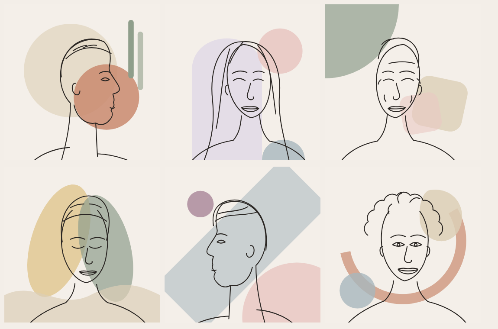

# Twinzies

Evidence-grounded **digital-twin personas** for usability testing and UX research, packaged as a Claude skill.

Twinzies builds 4 to 12 named twins from what real people say in public (Reddit, forums, reviews) plus exports you paste in (Facebook groups, X, Threads) and your own first-party data. The twins then walk through your app, site, codebase or design and report on functionality, language, visual design, UI, hierarchy and accessibility. Every finding traces back to evidence, and every twin stays a **hypothesis until real users confirm it**.

## What you get

- **Twin builder.** Personas derived from needs, quotes and behaviours, not demographics. Each carries an evidence log with sources and confidence.
- **A library that grows.** New project? Twinzies matches against existing twins first (reuse, adapt or build new), then versions and logs every change.
- **Evaluations.** Twin-led walkthroughs with severity ratings, WCAG checks and an HTML report.
- **Research pairing.** Twins generate hypotheses; the skill hands you prompts and scripts to test them with real people (in-product micro-surveys, think-aloud sessions, screeners).
- **Studies, insights, decisions.** Evidence → insight → solution, many insights per solution. Review each proposal in chat and choose **do it / backlog / dismiss**.
- **App store reviews.** Apple App Store and Google Play reviews as evidence, with an intake script that strips reviewer identities and a guide to getting them without bypassing store rules.
- **Misuse twins.** Careless, boundary-testing, scammer, harasser and scraper archetypes find abuse cases and mitigations, defensively. No exploits or attack scripts.
- **Journey maps and a11y audits** as companion skills.
- **Dashboard.** One self-contained HTML file: twins, studies, insight map, decisions, changelog and the prompt playbook.

## The skill family

| Skill | What it does |
|---|---|
| [`twinzies`](skills/twinzies) | Build, reuse and improve twins; evaluate products; pair with real-user research; studies, insights and decisions; **misuse mode** for careless, unexpected and malicious use |
| [`twinzies-journeys`](skills/twinzies-journeys) | Evidence-labelled journey maps, overlays and service blueprints, exportable to **FigJam, MURAL and Miro** (sticky grids, CSV, SVG, board spec) |
| [`twinzies-a11y`](skills/twinzies-a11y) | WCAG 2.2 accessibility audits: static scan, manual checklist, accessibility personas, honest not-run list |

## Install

1. Download the `.skill` files in `dist/` (or zip each folder in `skills/`).
2. In Claude, open Settings → Capabilities → Skills and upload it.
3. Start any chat with: `Use Twinzies. Find or create my twin library.`

## Start here

| Folder | What it shows |
|---|---|
| [`examples/01-build-your-twins`](examples/01-build-your-twins) | Six twins built for a physical-media app, with evidence log and avatars |
| [`examples/02-evaluate-a-prototype`](examples/02-evaluate-a-prototype) | Running those twins over a prototype and reading the report |
| [`examples/03-validate-with-real-users`](examples/03-validate-with-real-users) | Working like a UX researcher: hypotheses, screeners, scripts, logging results |
| [`examples/04-library-and-dashboard`](examples/04-library-and-dashboard) | Library layout, the decision flow and the dashboard |
| [`examples/prompts.md`](examples/prompts.md) | 13 research prompts, broad to specific |

## How twins are built

1. **Frame** the product, audience and needs.
2. **Gather** public discussion and pasted exports; record source, date and context, never personal identities.
3. **Cluster** by need and behaviour, not by who posted.
4. **Write** each twin with goals, frustrations, vocabulary, accessibility needs and quotes paraphrased from evidence.
5. **Label** status `hypothesis`, then `corroborated`, then `validated` only after real-user data.

## Honest limits

Twins are a fast, cheap way to find likely problems and form research questions. They are not participants. Treat their output as hypotheses and confirm anything high-stakes with real people. Illustrated avatars are visual archetypes, not evidence.

## Privacy

Don't paste private data you don't have the right to use. Twin files store paraphrased needs, not usernames. Keep your own library (`twinzies-library/`) out of version control; it is git-ignored here.

## License

MIT
